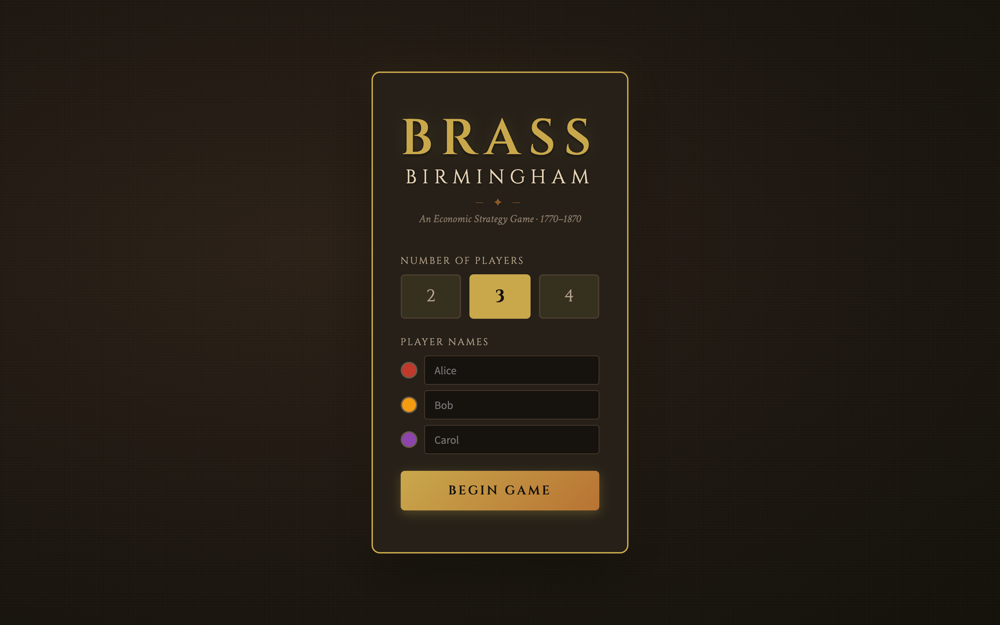
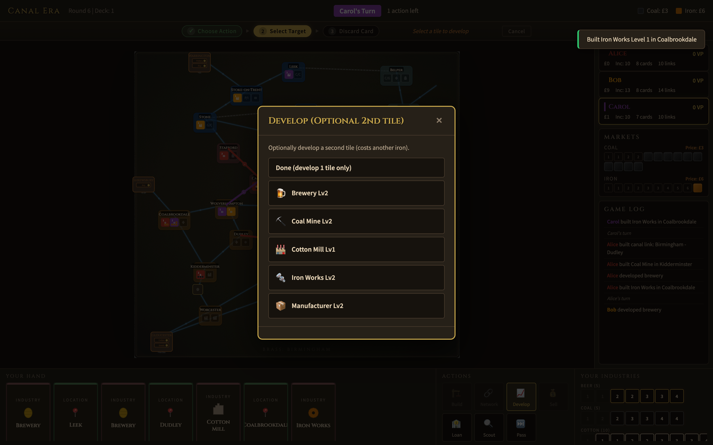
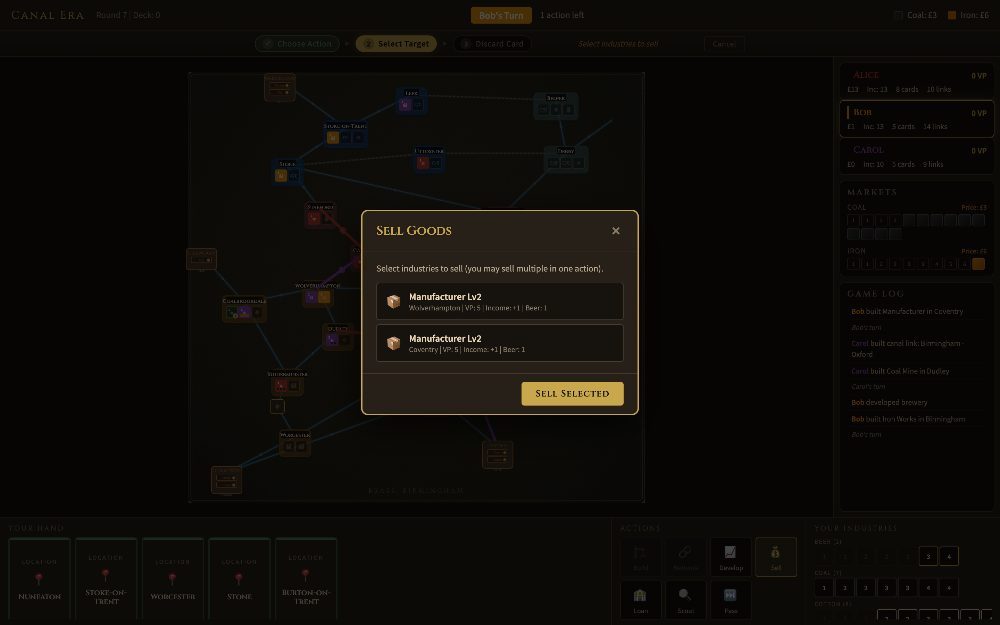
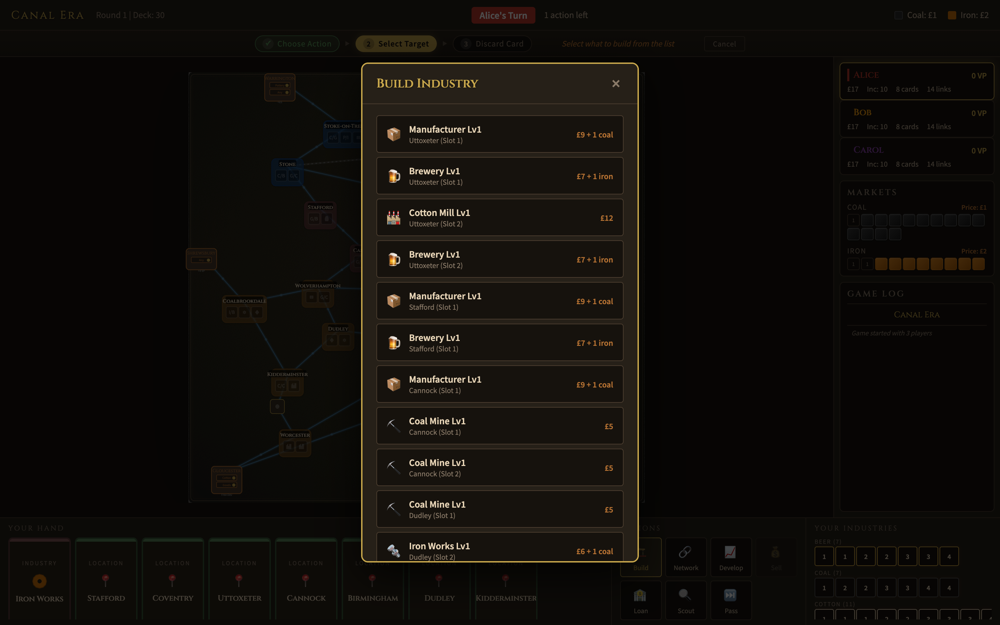
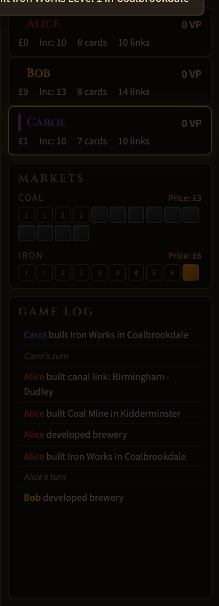
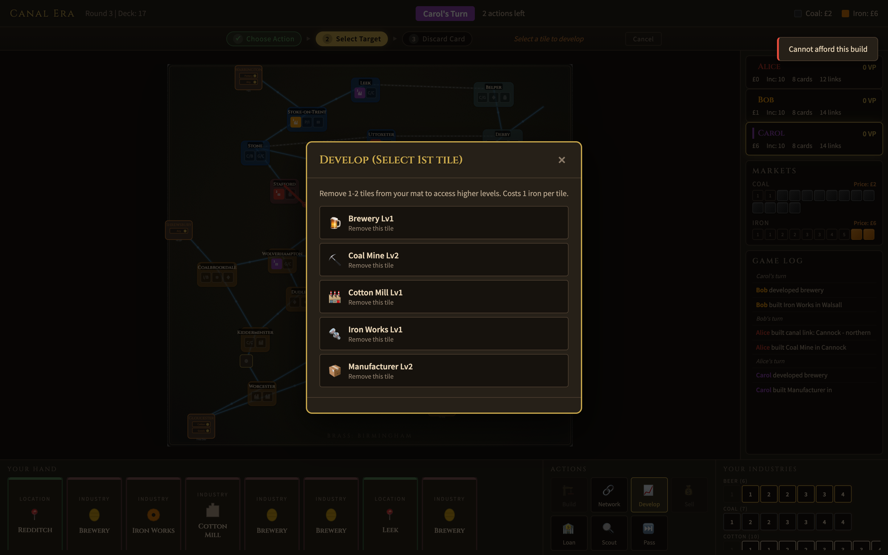
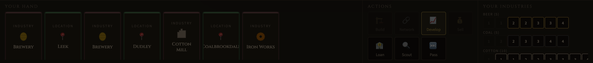
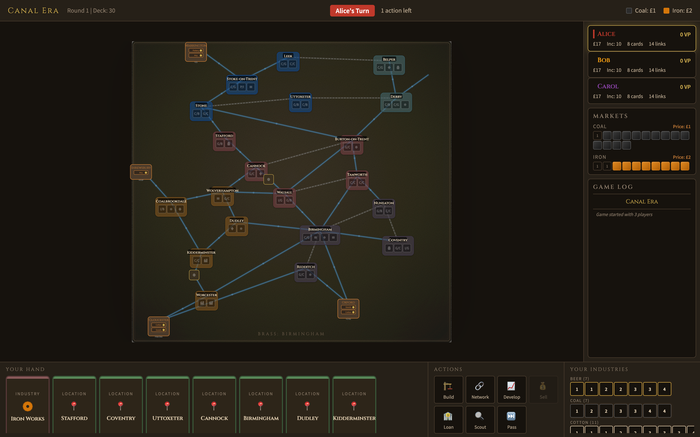

# Brass: Birmingham

[](https://mintlify.com/npow/brass-birmingham)

A digital adaptation of the award-winning board game by Roxley Games. Build your industrial empire across the English Midlands during the height of the Industrial Revolution (1770-1870).

> **Note:** This is an unofficial fan project. [Brass: Birmingham](https://roxley.com/products/brass-birmingham) is designed by Gavan Brown, Matt Tolman, and Martin Wallace, published by Roxley Games. Please support the original by purchasing the physical game.



---

## The Game

Compete as rival entrepreneurs in Birmingham and its surrounding towns. Establish canals and railways, develop industries, and outmaneuver your opponents across two distinct eras.

**2-4 Players** · **Canal Era + Rail Era** · **Online Rooms + Saved Sessions**

### Two Eras of Industry

**Canal Era (1770-1830)** — Build canals and establish your first industries. Only one tile per location. At the end, all canals and Level I tiles are removed — but Level II+ tiles carry over and score again.

**Rail Era (1830-1870)** — Build railways (requiring coal), expand aggressively with multiple tiles per location, and push for the highest score.



<p align="center"><em>Canal Era — industries built across the Midlands, canal links connecting the network</em></p>



<p align="center"><em>Rail Era — railways criss-cross the map as players race toward final scoring</em></p>

---

### Build Your Empire

Choose from six industry types, each with a unique strategic role:

| Industry | Role | Key Trait |
|----------|------|-----------|
| **Cotton Mills** | Sell goods for VP | Expensive but high-scoring |
| **Coal Mines** | Fuel rail links and industries | Cheap, strong income |
| **Iron Works** | Supply iron for building and development | Efficient, denies opponents |
| **Manufacturers** | 8 unique levels with varied rewards | Versatile and complex |
| **Potteries** | Massive VP potential (up to 20 VP) | High cost, requires planning |
| **Breweries** | Supply beer for selling goods | The most important industry |

Select what to build, where, and for how much — all costs including coal and iron sourcing are calculated automatically.



<p align="center"><em>Build action — choose from available industries at locations matching your cards</em></p>

---

### Clear Action Workflow

A plain **Action Forms** panel drives each turn in the current online implementation:

1. **Choose Action** — Use the form for Build, Network, Develop, Sell, Loan, Scout, or Pass
2. **Select Target** — Choose locations, slots, link lines, industries, merchants, and resource sources
3. **Submit Command** — The server validates the command, updates state, and broadcasts the result

Each form shows rule reasons when a command cannot currently be submitted, so you can see whether the blocker is a card, resource, network, pending decision, or turn-order rule.

---

### Game Log & Turn Transitions

A **game event log** records every action: builds, network links, sales, loans, scoring, and pending-decision resolutions.

Turn, era, round, current-player, and pending-decision state are shown in the main game summary.



<p align="center"><em>Player stats, markets, and game event history</em></p>

---

### Develop to Unlock Higher Tiers

Spend iron to remove low-level tiles from your player mat and access the powerful high-level industries underneath. Optionally develop two tiles at once.



<p align="center"><em>Develop action — skip past weak tiles to access Level III+ industries</em></p>

---

### Your Hand, Your Strategy

Play location cards to build anywhere on the map, or industry cards to build within your network. Manage your hand carefully — every action costs a card.

Cards show **inline SVG icons** matching each industry type, with colored top borders indicating card type (green for location, red for industry, gold gradient for wild).



<p align="center"><em>Bottom panel — your hand of cards, the seven available actions, and your remaining industry tiles</em></p>

---

### Atmospheric Board

The game board features:
- **Parchment texture** via SVG noise filters and a radial vignette
- **Double-line canal** connections (translucent blue water effect)
- **Rail connections** with track-tie patterns
- **Geometric SVG icons** on industry slots and built tiles (factory, diamond, gear, crate, vase, barrel)
- **City nodes** with dark label backdrops, inner shadow depth, and increased region color opacity
- **VP badges** on flipped tiles, player color strips on built tiles

---

### Era Scoring

At the end of each era, score VP from your flipped industry tiles and the links connecting them. Higher-level tiles placed in the Canal Era score in *both* eras.


<p align="center"><em>Canal Era scoring — link VP and industry VP tallied for each player</em></p>

---

## Development Status

This repository is being migrated from a static hotseat prototype into an online
multiplayer implementation inspired by
[terraforming-mars/terraforming-mars](https://github.com/terraforming-mars/terraforming-mars):

- `src/common`: shared TypeScript rules, static config, selectors, setup, and command engine
- `src/server`: authoritative Express + Socket.IO game room service
- `src/client`: React client using plain native form controls while rules are still being completed
- `tests`: Vitest unit tests organized by rules area
- `js` and `css`: legacy static implementation retained as migration reference

Implemented so far: setup, deck dealing, player boards, income track, markets,
player network, connected components, Pass, Loan, Scout, Develop, Build, Network,
Sell, merchant beer, merchant bonuses, era-end scoring, Canal-to-Rail cleanup,
Rail final scoring, rail double-link beer payment, round income, negative-income
manual liquidation choices and shortfall handling, deterministic randomized setup
turn order, command-level manual resource-source selection, Socket.IO
create/join/command flow, JSON-backed game persistence, static rules-data
integrity tests, saved player-session tokens for reconnects, Build/Develop/Network
context-filtered resource-source controls, Sell context-filtered beer-source
controls, negative-income decision controls, automatic active-player session
switching, manual saved-session view switching, existing-game room list with
saved-session join controls, a plain leave-room control backed by Socket.IO,
browser CORS support for the REST API, audited
city-slot/farm brewery/merchant/link/card/industry/market/core-rules/
income-track data manifests, legacy static-prototype parity tests,
official physical-component manifest,
player-count link availability and merchant-tile setup manifests,
client-side disabled-action rule reasons, and
audited setup/dealing/board-occupancy invariants, link-anchored rail coal
sourcing, the first rule test suite, and the optional introductory Canal-only
variant.

Still pending for a full Brass implementation: final face-by-face human
rules-data audit against the official card, board, industry tile, and merchant
tile faces using the checklist in
`docs/Brass_Birmingham_rules_data_model_cn.md`, plus later UI/UX polish beyond
the current plain native command forms.

---

## How to Play

### Quick Start

```powershell
npm install
npm run dev
```

Open [http://127.0.0.1:5173](http://127.0.0.1:5173) in your browser.
The API and Socket.IO server run on [http://127.0.0.1:3001](http://127.0.0.1:3001).
Useful HTTP endpoints:

- `GET /api/health` - server health check
- `GET /api/static-config` - public rules/static-data config and audit metadata
- `GET /api/games` - public game room summaries; the lobby shows connected clients, ended-game winners, and victory points
- `POST /api/games` - create a game
- `GET /api/games/:id` - observer or player-specific game state
- `POST /api/games/:id/commands` - submit an authoritative command

Socket.IO also supports `games:list:get` for the same public room-summary payload, emits `games:list` after game creation and successful commands, and accepts `game:leave` so a client can unbind from the current room before returning to the lobby.

Useful commands:

```powershell
npm test
npm run build
npm start
```

1. Choose 2-4 players and enter names
2. Create a game room
3. Share the game ID or URL hash with another browser tab
4. Submit actions through the plain forms



### On Your Turn

1. **Use the Action Forms** for Build, Network, Develop, Sell, Loan, Scout, or Pass
2. **Choose the card and targets** from the native form controls
3. **Select explicit resource sources** when you want to override automatic coal, iron, or beer sourcing
4. **Submit the action**; the authoritative server validates it and advances the game

Disabled action buttons show the rule reason in the form and as a tooltip (e.g. "No iron available", "Need at least 3 cards").

The game handles all resource sourcing (coal, iron, beer), market pricing, turn order, and scoring automatically.

### Tips for New Players

- **Build breweries early** — Beer is the most contested resource in the game
- **Watch the turn order** — Spending less money means going first next round
- **Develop to skip weak tiles** — Accessing Level III+ tiles is worth the iron cost
- **Build in the Canal Era for double scoring** — Level II+ tiles persist into the Rail Era
- **Don't ignore income** — It compounds every round and breaks final VP ties

---

## Rules Reference

This implementation follows the official Brass: Birmingham rulebook:

- **Coal** requires a connected source (mine or market via merchant link)
- **Iron** can be taken from any iron works on the board — no connection needed
- **Beer** for selling comes from your own breweries (anywhere), connected opponent breweries, or merchant barrels
- **Overbuilding** your own tiles requires same type + higher level; opponent coal/iron tiles can only be overbuilt when that resource is globally depleted
- **Pottery I and III** have the lightbulb icon and cannot be developed — they must be built
- **Turn order** each round goes to whoever spent the least money

---

## Architecture

Modern TypeScript web app with a server-authoritative rules engine.

| File | Purpose |
|------|---------|
| `index.html` | Vite entry for the React client |
| `src/common/staticData.ts` | Static rules data: locations, links, cards, industries, markets |
| `src/common/gameSetup.ts` | Deterministic game setup and initial state creation |
| `src/common/gameEngine.ts` | Command validation/execution for server-authoritative rules |
| `src/common/selectors.ts` | Network and connected-component helpers |
| `src/server/index.ts` | Express + Socket.IO server |
| `src/server/gameStore.ts` | In-memory multiplayer game room store |
| `src/client/main.tsx` | Plain React client and native action forms |
| `tests/**/*.spec.ts` | Unit tests for rules, setup, network, actions, and server store |
| `js/*.js`, `css/style.css` | Legacy prototype retained as migration reference |

---

## Credits

- **Brass: Birmingham** designed by Gavan Brown, Matt Tolman, and Martin Wallace
- Published by [Roxley Games](https://roxley.com)
- Tile data verified against the [Tabletop Simulator](https://github.com/ikegami/tts_brass) implementation by Kini/ikegami
- Board geography and card data referenced from community implementations

---

*Fan-made digital adaptation for personal and educational use. All game design credit belongs to the original designers and publisher.*
